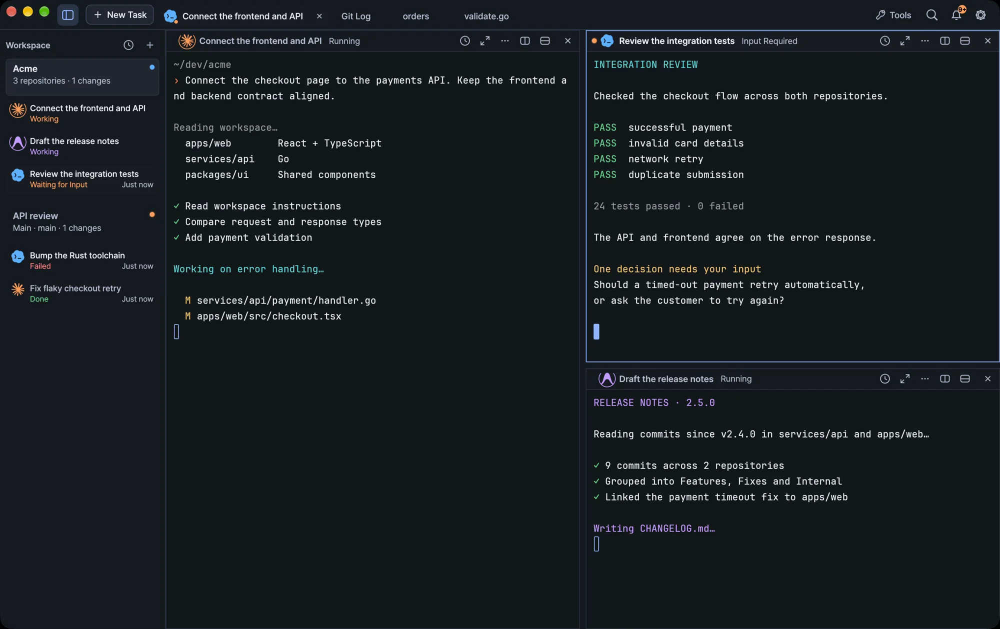
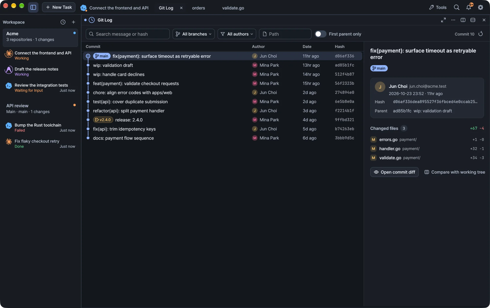
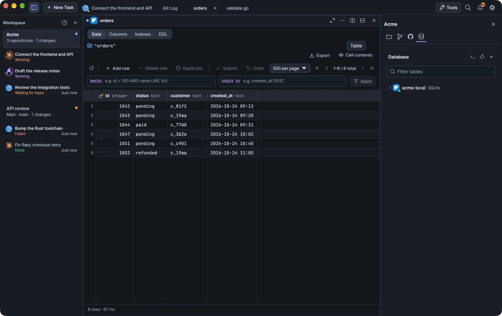
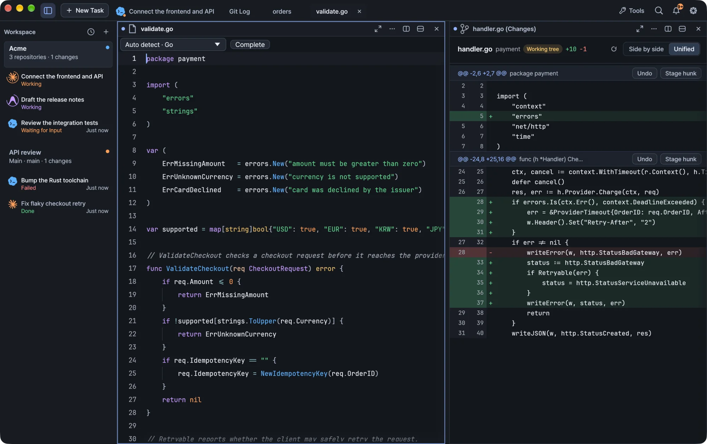
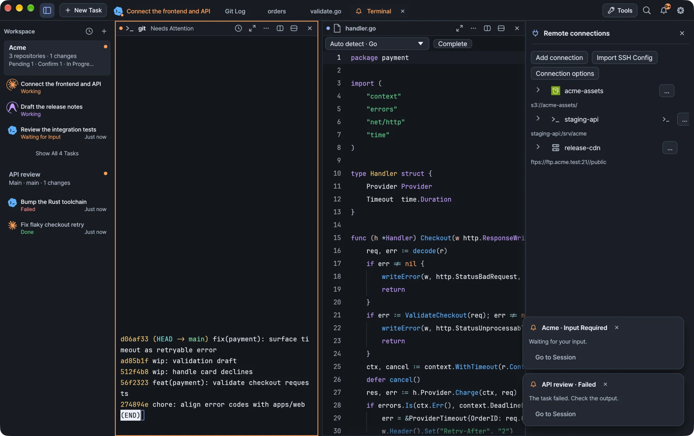

<p align="center">
  <a href="https://kiln.melona.cloud/"></a>
</p>

<h1 align="center">Kiln</h1>

<p align="center"><strong>The AI agent IDE, built around your terminal.</strong></p>

<p align="center">Claude Code, Codex and Antigravity in one native workspace.<br />
Close the window. Your sessions keep running.</p>

<p align="center">
  <a href="https://kiln.melona.cloud/">Website</a> ·
  <a href="https://github.com/YangTaeyoung/kiln/releases/latest">Download</a> ·
  <a href="https://kiln.melona.cloud/docs/">User guide</a> ·
  <a href="https://github.com/YangTaeyoung/kiln/issues">Report an issue</a>
</p>

<p align="center">
  <a href="https://github.com/YangTaeyoung/kiln/releases/latest"></a>
  <a href="docs/getting-started.md"></a>
  <a href="docs/windows-parity.md"></a>
  <a href="LICENSE"></a>
</p>

[](https://kiln.melona.cloud/)

<sub>Actual Kiln captures from an isolated demo workspace. Terminal messages and project data are illustrative.</sub>

Kiln is a free, open-source AI terminal and IDE built with Rust and egui. Keep your
agents, shells, Git, editor and databases in one app. Open a single repository or a
parent folder containing your frontend, backend and shared libraries, then work across
all of them from the same workspace.

## Get started

Download the app from [Releases](https://github.com/YangTaeyoung/kiln/releases/latest),
or install it from your terminal.

**macOS**

```sh
curl -fsSL https://raw.githubusercontent.com/YangTaeyoung/kiln/main/install.sh | sh
```

**Windows PowerShell**

```powershell
irm https://raw.githubusercontent.com/YangTaeyoung/kiln/main/install.ps1 | iex
```

| Platform | Requirements |
| --- | --- |
| macOS | macOS 11 or later, Apple Silicon. Official releases are signed and notarized. |
| Windows | Windows 11, x64 or ARM64. Executables are not code-signed yet; browser downloads may show SmartScreen. |

Open **Kiln**, choose your project folder, select **New Task** and pick an agent,
or start with a plain terminal. Install and sign in to the official agent CLIs you
use. Kiln uses your own accounts; agent subscriptions are separate.

Already installed? Check for updates in **Kiln → Check for Updates** on macOS or
**Settings → About → Check for Updates** on Windows.

[Installation and updates](docs/getting-started.md) ·
[English guide](https://kiln.melona.cloud/docs/) ·
[한국어](https://kiln.melona.cloud/ko/docs/) ·
[日本語](https://kiln.melona.cloud/ja/docs/) ·
[简体中文](https://kiln.melona.cloud/zh-cn/docs/)

## Keep the whole task in view

- **Agents, side by side.** Run Claude Code, Codex and Antigravity (`agy`) in separate
  terminals. The sidebar shows reported working, waiting, completed and failed states;
  click a task to reach its split. [Workspaces and agents](docs/workspaces.md)
- **Sessions beyond the window.** A local daemon keeps shells, agents, builds and
  servers running when the GUI closes or updates. Reopen Kiln to return to your
  tasks, splits and drafts. A reboot or ending a process still ends its session.
  [Terminal recovery](docs/terminal-recovery.md)
- **One request across repositories.** Open a parent folder as the agent's working
  root and choose repositories independently for Git operations. Give the same folder
  multiple named workspaces with their own tasks and layouts. [Workspaces](docs/workspaces.md)
- **Continue in another agent.** Opt a workspace into conversation sync, then use
  `/resume` to continue between Claude Code and Codex. Bring Antigravity conversations
  into either tool as well; that path reads from Antigravity and does not write back.
  [Conversation sync](docs/conversation-sync.md)
- **Accounts and CLI updates.** Save and switch Claude Code and Codex accounts, follow
  their usage, and update CLIs with an optional restart in the same conversation.
  Antigravity account management and conversation tracking are available on macOS.
  [Accounts](docs/accounts.md) · [Antigravity](docs/antigravity.md) · [CLI updates](docs/cli-updates.md)

## Code, changes and data beside your terminal

| Tool | What you can do |
| --- | --- |
| [Git and GitHub](docs/git.md) | Review diffs and pull requests, browse branches, squash selected commits and cherry-pick changes. GitHub features use your authenticated `gh` CLI. |
| [Editor and search](docs/editor.md) | Edit files with language-server support and search the project without changing apps. |
| [Databases](docs/databases.md) | Open PostgreSQL, MySQL, MariaDB and SQLite connections, SQL consoles, completion and editable grids. |
| [Remote files and SSH](docs/remote-files.md) | Browse S3, OCI, GCS, Cloudflare R2, FTP/FTPS and SFTP, then open an SSH terminal alongside your work. |
| [Terminal integration](docs/terminal-integration.md) | Follow command activity, history and notifications. Zsh also has [inline completion](docs/shell-completion.md). |

<details>
<summary><strong>See the tools in Kiln</strong></summary>

### Git history

Browse commit history and inspect changes without leaving the workspace.



### Database grids

Inspect rows, filter results and prepare edits beside your agent sessions.



### Code editor

Open project files in the same tab and split layout as your terminals.



### Remote files

Browse remote connections and files from the workspace tools.



</details>

## Build and contribute

```sh
git clone https://github.com/YangTaeyoung/kiln.git
cd kiln
cargo run -p kiln -- /path/to/workspace
```

Start with [development](docs/development.md) for prerequisites and tests, or the
[documentation index](docs/README.md) for architecture and feature guides.
Maintainers and AI contributors should read [AGENTS.md](AGENTS.md) and the
[release runbook](docs/maintainers/releases.md).

The app UI supports English, Korean, Japanese and Simplified Chinese.
See [localization](docs/localization.md) to contribute a translation.

## License

[MIT](LICENSE) © 2026 Taeyoung Yang. Bundled assets and dependencies retain their
own licenses; see [third-party notices](THIRD_PARTY_NOTICES.md).
